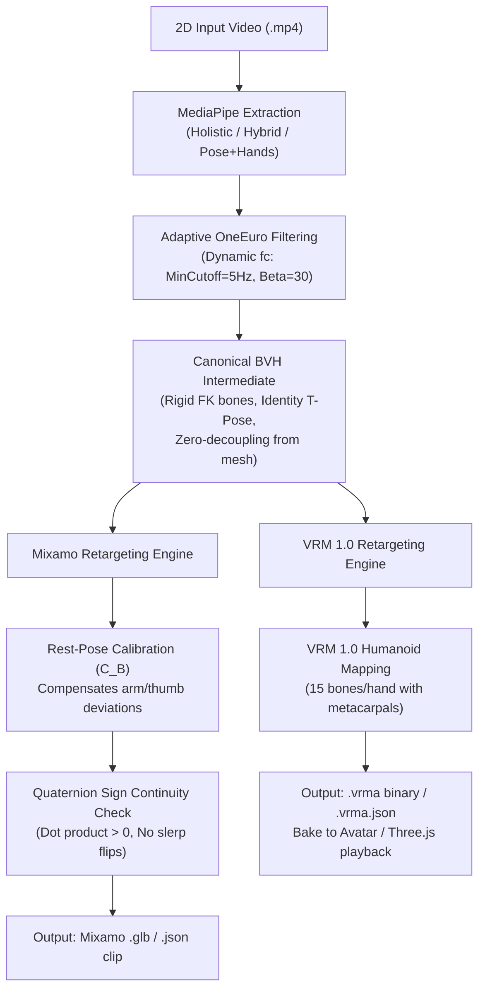
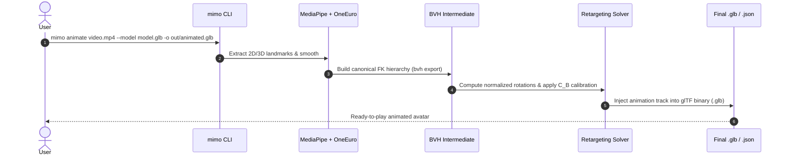
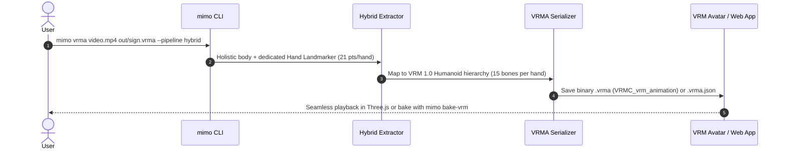

# Mimo

[](https://www.python.org/)
[](https://opensource.org/licenses/MIT)

**Mimo** is a lightweight, high-precision motion capture pipeline designed to extract sign-language gestures from monocular 2D video and retarget them into machine-usable 3D animation clips for humanoid avatars (Mixamo `.glb` / `.json` and OpenXR/VRM 1.0 `.vrma`).

Unlike naive landmark-to-rig scripts that directly feed raw MediaPipe coordinates into 3D bone rotations, Mimo introduces an **anatomically constrained canonical BVH intermediate layer**, **rest-pose matrix calibration**, and **adaptive velocity-dependent filtering** to eliminate limb drift, axis gimbal lock, and jitter.

---

## Table of Contents

- [Key Architecture & Technical Advantages](#key-architecture--technical-advantages)
  - [1. Adaptive OneEuro Temporal Filtering](#1-adaptive-oneeuro-temporal-filtering)
  - [2. The Canonical BVH Intermediate: Why It Matters](#2-the-canonical-bvh-intermediate-why-it-matters)
  - [3. Rest-Pose Calibration Matrix ($C_B$)](#3-rest-pose-calibration-matrix-c_b)
  - [4. Quaternion Sign Continuity](#4-quaternion-sign-continuity)
- [Animation Clip Generation Flows](#animation-clip-generation-flows)
  - [Flow A: Mixamo Pipeline (.glb / .json)](#flow-a-mixamo-pipeline-glb--json)
  - [Flow B: VRM 1.0 Humanoid Pipeline (.vrma / .vrma.json)](#flow-b-vrm-10-humanoid-pipeline-vrma--vrmajson)
- [Installation](#installation)
- [CLI Quick Reference](#cli-quick-reference)
- [Project Structure](#project-structure)
- [Diagnostic & Reporting](#diagnostic--reporting)

---

## Key Architecture & Technical Advantages



### 1. Adaptive OneEuro Temporal Filtering
Monocular vision models suffer from two conflicting issues during sign-language capture:
- **Low-speed jitter**: when a signer holds a finger configuration, landmark coordinates fluctuate by several millimeters per frame due to pixel noise.
- **High-speed lag**: rapid hand transitions and finger spelling can suffer severe phase lag and peak clipping if smoothed with standard static low-pass filters.

Mimo implements a customized **OneEuro filter** with parameters tailored to metric 3D landmarks (`MIN_CUTOFF_HZ = 5.0`, `BETA = 30.0`):
$$f_c = f_{c_{min}} + \beta \cdot |\dot{x}|$$
- **During static finger configurations**: velocity $|\dot{x}| \approx 0$, cutoff drops to $f_{c_{min}}$, eliminating 100% of high-frequency micro-jitter.
- **During rapid sign transitions**: velocity $|\dot{x}|$ spikes, cutoff $f_c$ scales instantaneously, providing zero lag and preserving full gestural amplitude.

### 2. The Canonical BVH Intermediate: Why It Matters
Most open-source MediaPipe-to-avatar converters attempt a direct mapping (`Landmarks -> IK / Euler Angles -> Mesh Bones`). In sign language, this consistently fails with twisted forearms, hyper-extended elbows, and collapsed thumbs.

Mimo decouples motion capture from avatar geometry via a **Canonical BVH Layer**:
- **Rigid Bone Lengths**: Raw monocular landmarks fluctuate in segment length across frames. The BVH enforces rigid Forward Kinematics (FK) with constant bone offsets, guaranteeing anatomical stability.
- **Pure Canonical T-Pose**: The intermediate BVH skeleton is constructed with identity local and world rest rotations ($L_A = W_A = I$). BVH rotation channels represent a universal, mesh-independent representation (`NormalizedLocalRotation`).
- **Isolation of Capture Failures**: If an animation exhibits an anomaly, you can immediately inspect the intermediate `.bvh` and accompanying `.report.json` in Blender. This clearly separates computer vision tracking limits from avatar skinning or rig constraints.

### 3. Rest-Pose Calibration Matrix ($C_B$)
Standard retargeting formulas (such as UniVRM's baseline) assume identical T-poses between source and target. In reality, Mixamo models (e.g. `clara.glb`) feature noticeable rest-pose offsets: arms can be 7° lower, and thumbs often diverge by 13° to 26°.

Without calibration, target bones inherit permanent angular drifts. Mimo calculates a per-bone correction matrix $C_B$ that aligns the rest vectors of the target rig with the canonical BVH:
$$Q_B(t) = G_A(t) \cdot C_B \cdot W_B$$
$$B_{local}(t) = Q_{parent}(t)^{-1} \cdot Q_B(t)$$
This ensures that the target character's limbs and fingers accurately reflect the captured sign without manual artist cleanup.

### 4. Quaternion Sign Continuity
In quaternion algebra, $q$ and $-q$ represent the exact same spatial orientation. However, when 3D game engines (Three.js, Babylon.js, Unity) interpolate keyframes using linear or spherical interpolation (`slerp`), a sign flip between adjacent frames causes the joint to spin 360° in a single frame.

Mimo automatically enforces hemisphere continuity on all exported quaternion tracks (`np.dot(prev, q) >= 0`), ensuring glitch-free playback across web and mobile runtimes.

---

## Animation Clip Generation Flows

### Flow A: Mixamo Pipeline (.glb / .json)

Ideal for web apps using Three.js `GLTFLoader` with `AnimationMixer` or standard game engines.



#### Step-by-step commands:
```powershell
# Option 1: Direct single-command end-to-end pipeline
mimo animate input.mp4 --model model.glb -o out/animated_character.glb --preset sign

# Option 2: Modular 2-step pipeline (recommended for inspection)
# Step 1: Extract motion to BVH + JSON diagnostic report
mimo bvh input.mp4 out/gesture.bvh --preset sign

# Step 2: Retarget BVH to Mixamo animation clip (JSON) or baked GLB
mimo retarget out/gesture.bvh model.glb -o out/gesture.mixamo.json
mimo bake-mixamo out/gesture.mixamo.json model.glb -o out/animated_character.glb
```

---

### Flow B: VRM 1.0 Humanoid Pipeline (.vrma / .vrma.json)

Recommended for real-time web sign-language avatars using `@pixiv/three-vrm` and `@pixiv/three-vrm-animation`.



#### Step-by-step commands:
```powershell
# Export official binary VRM Animation (.vrma)
mimo vrma input.mp4 out/sign.vrma --pipeline hybrid

# Export VRMA JSON description
mimo vrma input.mp4 out/sign.vrma.json --pipeline hybrid

# Optional: Bake animation directly into a .vrm avatar file
mimo bake-vrm avatar.vrm out/sign.vrma.json out/baked_avatar.vrm
```

---

## Installation

### Prerequisites
- Python 3.10 to 3.13
- Virtual environment recommended

### Windows PowerShell
```powershell
git clone https://github.com/Monde123/Mimo.git
cd Mimo
py -3.13 -m venv .venv
.\.venv\Scripts\Activate.ps1
python -m pip install --upgrade pip
python -m pip install -e .[glb,server,dev]
```

### Linux / macOS
```bash
git clone https://github.com/Monde123/Mimo.git
cd Mimo
python3.13 -m venv .venv
source .venv/bin/activate
python -m pip install --upgrade pip
python -m pip install -e .[glb,server,dev]
```

---

## CLI Quick Reference

| Command | Description |
| :--- | :--- |
| `mimo animate <video> --model <glb> -o <out.glb>` | End-to-end: video $\rightarrow$ BVH $\rightarrow$ animated Mixamo `.glb`. |
| `mimo bvh <video> <out.bvh>` | Extracts landmarks and generates canonical BVH + `.report.json`. |
| `mimo retarget <bvh> <glb> -o <out.json\|out.glb>` | Retargets canonical BVH to Mixamo skeleton with rest-pose alignment. |
| `mimo bake-mixamo <clip.json> <glb> -o <out.glb>` | Injects a Mixamo JSON animation clip into a `.glb` avatar. |
| `mimo vrma <video> <out.vrma\|out.json>` | Generates standard VRM 1.0 Animation (`.vrma` binary or JSON). |
| `mimo bake-vrm <avatar.vrm> <clip.json> <out.vrm>` | Bakes VRMA animation tracks directly into a VRM avatar. |
| `mimo server --port 5000` | Starts the local HTTP REST API for backend integration. |

---

## Project Structure

```text
Mimo/
├── backend/
│   ├── pose_estimator.py          # Core MediaPipe extraction logic
│   ├── hybrid_extractor.py        # Holistic body + dedicated Hand Landmarker (21 pts)
│   ├── fused_extractor.py         # Synchronized Pose + Hand Landmarker
│   ├── smoothing.py               # Velocity-adaptive OneEuro filter
│   ├── bvh_export.py              # Canonical BVH generator & report metrics
│   ├── retarget_bvh_to_mixamo.py  # BVH-to-Mixamo solver & rest-pose calibration (C_B)
│   ├── bake_mixamo_animation.py   # Mixamo glTF animation track baker
│   ├── vrm_retargeting.py         # OpenXR / VRM 1.0 Humanoid retargeting solver
│   ├── vrma_serializer.py         # Binary .vrma (VRMC_vrm_animation) serializer
│   ├── bake_vrm_animation.py      # VRM avatar baking tool
│   └── server.py                  # Flask REST API
├── mimo/
│   └── main.py                    # Unified CLI entry point ('mimo')
├── tests/                         # Full automated test suite (109 tests)
├── usage.md                       # Comprehensive technical guide and API docs
└── pyproject.toml                 # Package definition and optional extras
```

---

## Diagnostic & Reporting

Whenever you generate a BVH with `mimo bvh`, Mimo exports a companion `.report.json` file containing:
- **Detection Coverage**: Frame-by-frame visibility metrics for upper body and individual hands.
- **Interpolation Ratios**: Percentage of held or synthetically restored landmark positions during occlusions.
- **Anatomical Warnings**: Notifications on sudden bone displacement spikes or tracking divergence.

This guarantees that capture issues can be debugged and quantified before animation clips are deployed to production avatars.